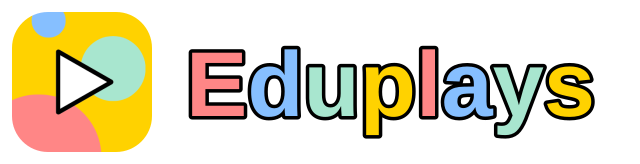

<p align="center">
  
</p>

# 🧠 Eduplays

A free browser game collection built with **React**, **Vite**, and **React Router**. The mini-games are designed for children, people with cognitive difficulties of any kind, and anyone who prefers a calm, low-pressure learning experience.

No account, no installation, no backend: everything runs in the browser.

---

## 🎮 Games

The catalog currently contains **30 mini-games** across **6 categories**.

### ➕ Math (5)
- **Matematica facile** — Solve an arithmetic operation (+, −, ×, ÷) and pick the correct result. Subtractions never go below zero and divisions are always exact.
- **Tabelline** — Practise the multiplication tables from 1 to 10.
- **Maggiore o minore** — Compare two numbers and choose the correct symbol: `>`, `<`, or `=`.
- **Sequenze numeriche** — Find the number that continues the sequence.
- **Doppio o metà** — Calculate the double or the half of a number.

### 🔤 Italian (9)
- **Sinonimi** — Pick the word with a similar meaning.
- **Contrari** — Pick the word with the opposite meaning.
- **Anagrammi** — Rearrange the shuffled letters to rebuild the hidden word, with an optional synonym hint.
- **Lettera mancante** — Complete a word by choosing the missing letter.
- **Sillabe** — Count the syllables in a word.
- **Tempi verbali** — Complete sentences with the correct verb tense: present, past, or future.
- **Il suono H** — Choose between forms with H (ho, hai, ha, hanno) and without H (o, ai, a, anno).
- **Le doppie** — Pick the word spelled with the correct double consonant.
- **Il suono GL** — Choose the word spelled with GLI.

### 💬 English (4)
- **Animali in inglese** — Look at the animal and choose its English name.
- **Colori in inglese** — Match each colour with its English name.
- **Numeri in inglese** — Learn the numbers from 1 to 12 in English.
- **Oggetti di scuola** — Discover the English names of common school objects.

### 🌍 Geography (6)
- **Indovina le bandiere** — A country flag appears on screen. Pick the matching country name.
- **Capitali del mondo** — Guess the capital city for the country shown.
- **Memory bandiere** — Flip the cards and find all matching flag pairs.
- **Capoluoghi d'Italia** — Match each Italian region with its capital.
- **Regioni dal capoluogo** — Find the Italian region that belongs to a capital city.
- **Aree d'Italia** — Identify whether each Italian region is in the North, Centre, South, or Islands.

### 🎨 Colors (3)
- **Indovina i colori** — Read a colour name and click the matching coloured tile.
- **Memory colori** — Flip the cards and find all matching colour pairs.
- **Mescola i colori** — Discover the colour produced by mixing two colours, or the pair that creates a given colour.

### 🧩 Logic (3)
- **Trova l'intruso** — Pick the item that does not belong to the group.
- **Sequenze di forme** — Find the shape that continues the visual pattern.
- **Memory animali** — Find all eight pairs of animal cards.

Every quiz game starts in **Senza tempo** (calm mode) and offers an optional 30-second challenge. Difficulty is shown only when it changes the content: some games have 3 levels (Base, Facile, Medio), others 5. Memory games are always untimed.

### 📚 Didattica

The `/didattica` page hosts **12 free downloadable lessons**. Every lesson includes:

- a **2-page A4 worksheet** with the theory explained in simple words, 8 exercises, a fun final challenge, and the solutions at the bottom;
- a **7-slide 16:9 presentation** for classroom use.

Topics cover Italian, maths, and colours.

### Designed to be welcoming

- **Calm by default** — no countdown unless the player chooses one.
- **Big, clear controls** — generous touch targets and a high-contrast comic style.
- **Immediate feedback** — right and wrong answers are explained with icons and text.
- **Records and stars** — progress is saved locally, with a star rating and a "new record" message.
- **Sound under control** — one button mutes every effect and remembers the choice.
- **Accessible by design** — skip link, focus management, keyboard-friendly controls, labelled buttons, live feedback, and `role="timer"` / `role="progressbar"` where relevant.
- **Dyslexia-friendly typography** — the interface uses Atkinson Hyperlegible.
- **No account required** — everything runs in the browser.

---

## 🚀 Getting Started

### Prerequisites

- **Node.js** `^20.19.0 || >=22.12.0`
- **npm** ≥ 10

### Installation

1. Clone the repository:

   ```bash
   git clone https://github.com/DRosarioDev/eduplays.git
   cd Eduplays
   ```

2. Install dependencies:

   ```bash
   npm install
   ```

3. Start the development server:

   ```bash
   npm run dev
   ```

The app will be available at [http://localhost:5173](http://localhost:5173).

### Build for production

```bash
npm run build
```

### Preview the production build

```bash
npm run preview
```

---

## 🧪 Available Scripts

| Command | Description |
|---|---|
| `npm run dev` | Start the local dev server on port 5173. |
| `npm run build` | Create a production build in `dist/`. |
| `npm run preview` | Preview the production build locally. |
| `npm run deploy` | Build and deploy to Cloudflare with Wrangler. |
| `node scripts/validate-question-banks.mjs` | Check question-bank coverage per difficulty level. Exits with an error if an included bank has fewer than 100 items. |

---

## 🛠️ Built With

[](https://react.dev/)
[](https://vite.dev/)
[](https://reactrouter.com/)
[](https://workers.cloudflare.com/)

---

## 📁 Project Structure

```text
src/
├── pages/                     # One page per game, plus Home/Help/Didattica/404
│   ├── Home.jsx               # Game selection menu
│   ├── Help.jsx               # Help and game rules
│   ├── Didattica.jsx          # Downloadable teaching materials
│   ├── NotFound.jsx           # 404 page
│   ├── MathOperations.jsx
│   ├── Multiplication.jsx
│   ├── GreaterOrLesser.jsx
│   ├── MathSequences.jsx
│   ├── MathDoubleHalf.jsx
│   ├── Synonym.jsx
│   ├── Antonym.jsx
│   ├── Anagram.jsx
│   ├── ItalianMissingLetter.jsx
│   ├── ItalianSyllables.jsx
│   ├── ItalianVerbTenses.jsx
│   ├── ItalianHSound.jsx
│   ├── ItalianDoubleConsonants.jsx
│   ├── ItalianGlSound.jsx
│   ├── EnglishQuiz.jsx        # Shared page for the four English games
│   ├── Flag.jsx
│   ├── CapitalWorld.jsx
│   ├── ItalianRegions.jsx     # Exports the three region games
│   ├── Color.jsx
│   ├── ColorMixing.jsx
│   ├── MemoryColor.jsx
│   ├── MemoryFlag.jsx
│   ├── MemoryAnimals.jsx
│   ├── LogicOddOneOut.jsx
│   └── LogicPatterns.jsx
├── components/
│   ├── AnswerButton.jsx       # Shared answer button
│   ├── CardGame.jsx           # Reusable game card for Home
│   ├── CardMemoryGame.jsx     # Single card for Memory games
│   ├── ChoiceQuiz.jsx         # Shared multiple-choice quiz engine
│   ├── Difficulty.jsx         # Difficulty selector
│   ├── FlagQuiz.jsx           # Shared flag/capital quiz
│   ├── Footer.jsx             # Site footer
│   ├── GameArt.jsx            # Lightweight card illustrations
│   ├── GameScreen.jsx         # Shared shell for start/play/score states
│   ├── Header.jsx             # Site header, navigation, and sound toggle
│   ├── MathQuiz.jsx           # Shared arithmetic quiz logic
│   ├── MemoryGameEngine.jsx   # Shared shell for Memory games
│   ├── NotificationContext.jsx # Snackbar notifications
│   ├── Score.jsx              # End-of-game score screen
│   ├── SoundProvider.jsx      # Sound preference provider
│   ├── StartComponent.jsx     # Reusable start screen (timer/difficulty)
│   ├── Timer.jsx              # Optional 30-second countdown
│   └── WordQuiz.jsx           # Shared synonym/antonym quiz
├── context/
│   └── soundContext.js        # Sound context
├── data/
│   ├── games.js               # Single catalog of games, rules, routes, records
│   └── didattica.js           # Catalog of downloadable lessons and PDFs
├── hooks/
│   ├── useGameEngine.js       # Shared state for quiz-style games
│   ├── useSound.js            # Sound effects (Web Audio API + MP3)
│   ├── useSoundSettings.js    # Read/write the sound preference
│   └── usePreloadImages.js    # Preload images once on mount
├── utils/
│   ├── answerState.js         # Correct/wrong visual state helper
│   ├── formatCount.js         # Italian singular/plural helper
│   ├── memoryDeck.js          # Shuffle and deck builder for Memory games
│   ├── questionDeck.js        # Weighted question deck across 3 levels
│   ├── storage.js             # Local records and storage helpers
│   └── tones.js               # Shared pastel board colours
├── assets/
│   ├── flags/country-flag.json
│   ├── words_it.json
│   ├── anagramWords.js
│   ├── animalMemory.js
│   ├── colorMixes.js
│   ├── colors.js
│   ├── englishVocabulary.js
│   ├── italianDoubleConsonants.js
│   ├── italianGlSound.js
│   ├── italianHSound.js
│   ├── italianPracticeWords.js
│   ├── italianRegions.js
│   ├── italianVerbTenses.js
│   ├── logicPatterns.js
│   ├── mathDoubleHalf.js
│   ├── mathSequences.js
│   ├── memoryColor.js
│   ├── oddOneOut.js
│   ├── logo/
│   └── thumbnails/
├── styles/                    # Global CSS, split by section
│   ├── variables.css
│   ├── layout.css
│   ├── header.css
│   ├── home.css
│   ├── start-component.css
│   ├── game.css
│   ├── color-game.css
│   ├── memory-game.css
│   ├── games-extra.css
│   ├── score.css
│   ├── footer.css
│   ├── anagram.css
│   ├── help.css
│   ├── didattica.css
│   └── responsive.css
├── App.jsx                    # Router, providers, and app shell
├── constants.js               # App name, version, and tagline
├── index.css                  # Imports everything from ./styles
└── main.jsx                   # React entry point

public/
├── favicon.ico
├── robots.txt
├── sitemap.xml
├── downloads/didattica/       # 24 PDF lesson sheets and slide decks
└── sounds/                    # Sound effects

scripts/
└── validate-question-banks.mjs

index.html
vite.config.js
wrangler.toml
eslint.config.js
package.json
```

---

## 🌐 Deployment

```bash
npm run deploy
```

This runs `npm run build` and then `wrangler deploy`. The `wrangler.toml` file publishes the contents of `dist/` as Cloudflare Workers static assets.

You need an authenticated Wrangler CLI with access to the Cloudflare account that owns the project. Run `wrangler login` once if you have not already done so.

---

## 📜 License

Licensed under the **[GNU AGPL v3.0](./LICENSE)**. Any modified version run on a public server must make its source code available to users.

---

## 🤝 Contributing

Contributions are welcome! In short:

1. **Fork** the repository.
2. **Create** a branch for your feature or fix:

   ```bash
   git checkout -b feature/your-feature-name
   ```

3. **Commit** your changes with a descriptive message:

   ```bash
   git commit -m "Add: brief description of your change"
   ```

4. **Push** the branch to your fork:

   ```bash
   git push origin feature/your-feature-name
   ```

5. **Open a Pull Request** against the `main` branch.

Before submitting, make sure the project builds and lints without errors:

```bash
npm run build
npm run preview
```

### Ideas for contributions

- 🆕 New games (geometry/shapes, fractions, punctuation, more Italian vocabulary)
- ♿ High-contrast mode, larger text, adaptive difficulty
- 🌍 Internationalization (i18n) support
- 🧪 Unit and integration tests
- 🎨 UI/UX enhancements and animated transitions

For the full workflow, architecture notes, and instructions for adding a game or a question bank, read **[CONTRIBUTING.md](./CONTRIBUTING.md)**.

Please keep PRs focused and make sure the app builds without errors before submitting.
